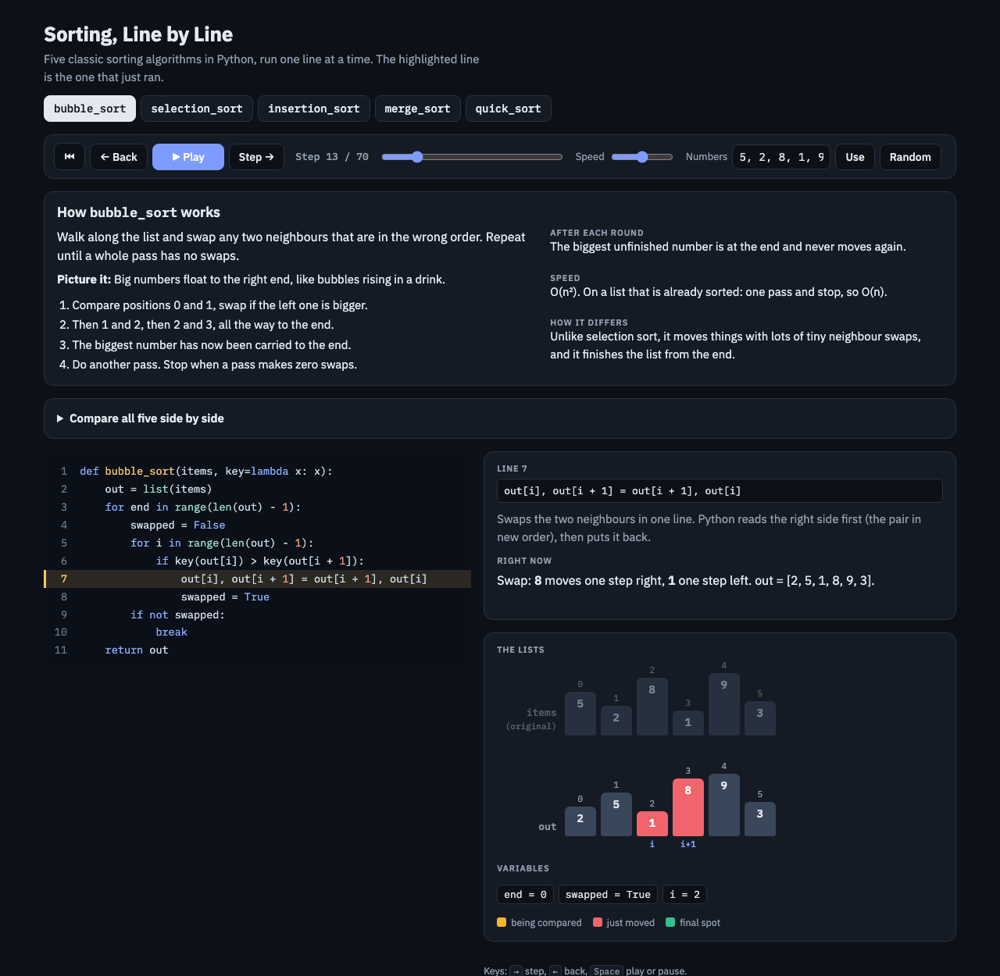
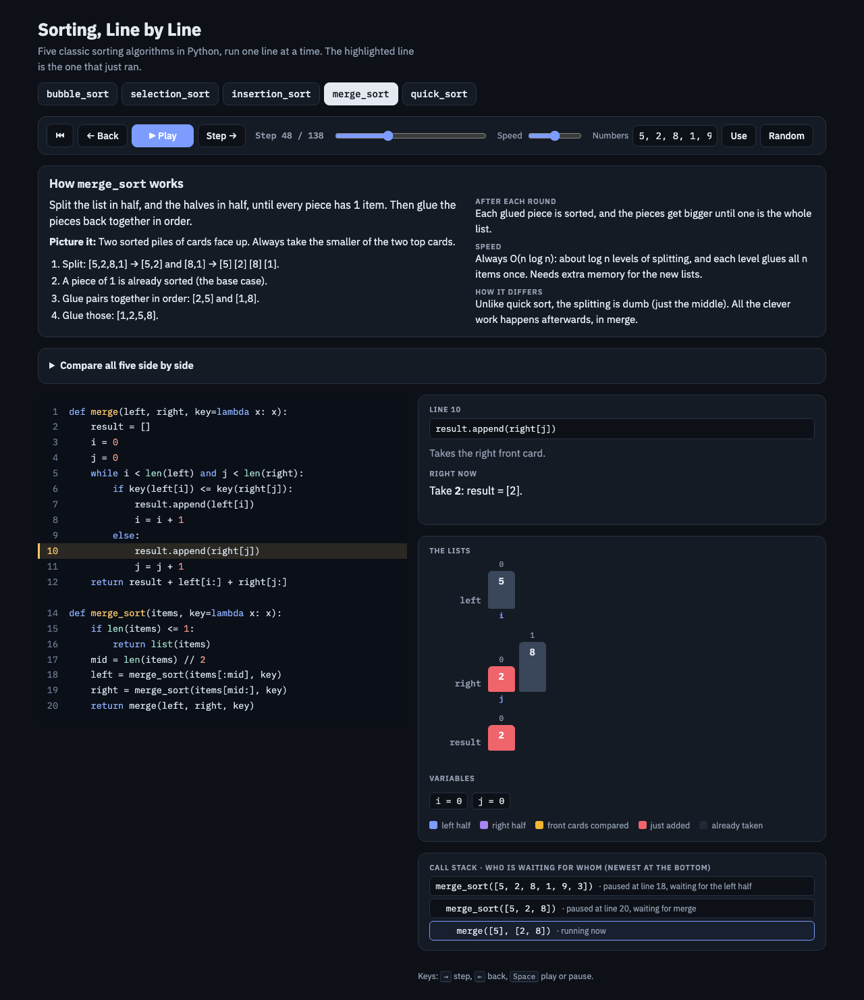
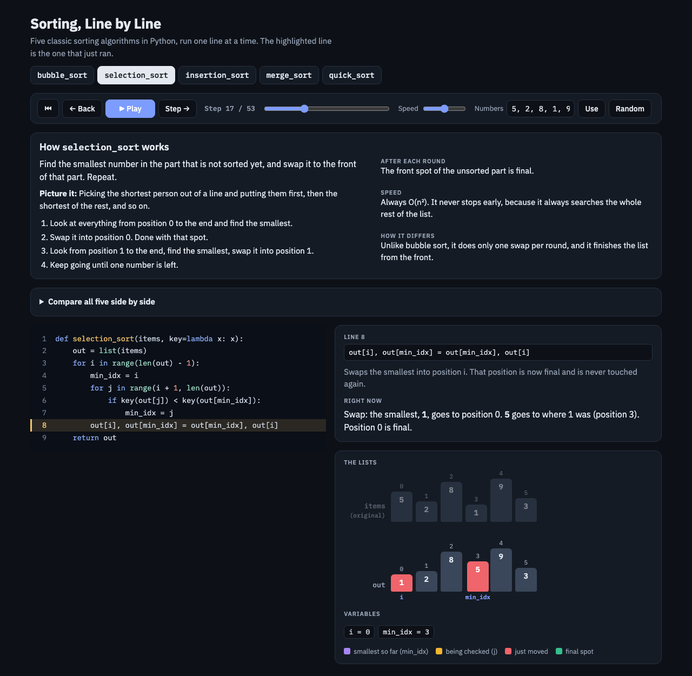
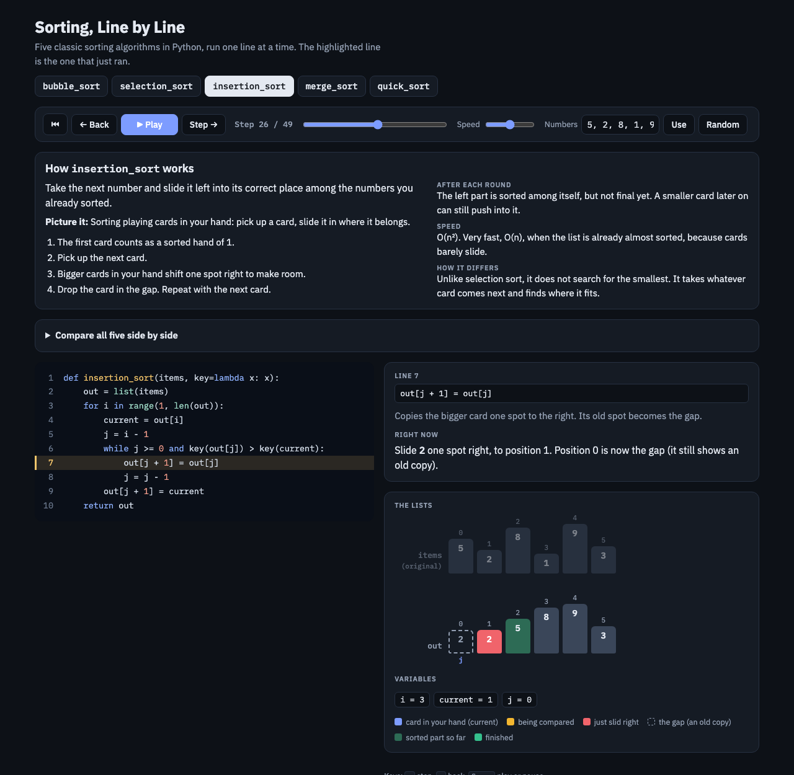
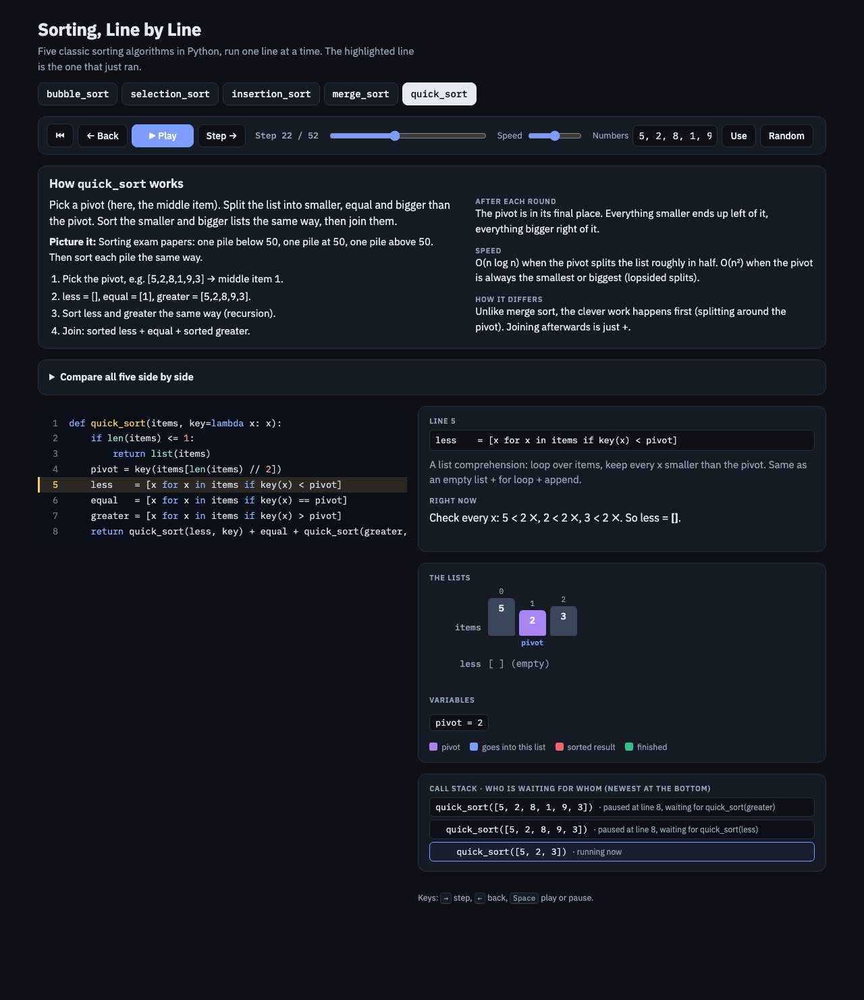
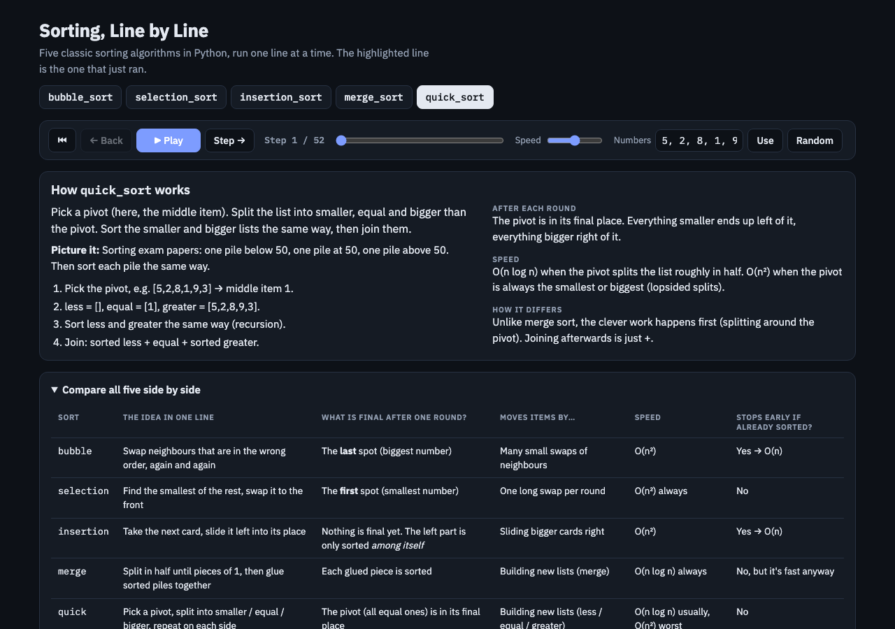

# Sorting, Line by Line

An interactive, step-by-step visualizer for five classic sorting algorithms in Python: **bubble, selection, insertion, merge and quick sort**.

Each step runs one line of the real Python code. The page highlights that line and explains it in plain English: what the line does in general, and what it did right now with the actual numbers. Meanwhile it shows the list, the variables and, for the recursive sorts, the call stack.

I built it while studying searching and sorting in *Programming, Algorithms and Data Structures* at CBS (MSc Data Science). The code is the same as my solutions to the course exercise.

**▶ Try it: [pellepico.github.io/sorting-line-by-line](https://pellepico.github.io/sorting-line-by-line/)**, or download `index.html` and open it in a browser. It's a single file with no installs.

## What you see

*Bubble sort, mid-swap. The left side is the Python code, with the line that just ran highlighted. On the right:*
- *"What this line does" is the general meaning of the line.*
- *"Right now" is what it did with the actual numbers.*
- *Below that is the list, with the pointers `i` and `i+1` under the two neighbours being swapped (red), and the current loop variables.*

*Merge sort, deep inside the recursion. The **call stack** at the bottom shows which calls are paused and what each one is waiting for:*
- *`merge_sort([5, 2, 8, 1, 9, 3])` waits for its left half.*
- *`merge_sort([5, 2, 8])` waits for `merge`.*
- *`merge([5], [2, 8])` is running and has just taken 2 from the right pile.*

<table>
<tr>
<td></td>
<td></td>
</tr>
<tr>
<td><em>Selection sort: the smallest number so far (purple, <code>min_idx</code>) is swapped into the front spot, and the green spots on the left are final.</em></td>
<td><em>Insertion sort: bigger cards slide right, and the dashed box is the gap where the held card (<code>current</code>) will land.</em></td>
</tr>
</table>

*Quick sort: the pivot (purple) and the list comprehension that builds `less`. Every item is checked against the pivot, with ✓ / ✗ shown in the text.*

*Each tab starts with a short "How it works" box: the idea, an everyday picture, four small steps, what is final after each round, speed, and how it differs from the sort it is most often confused with. The table compares all five side by side.*

## Features

- **The real code, line by line:** no pseudocode. All five functions take `items` and an optional `key`, and return a new sorted list without changing the input.
- **Two explanations per step:** the general meaning of the line, and what it did with the current values.
- **Colour-coded state:** what is being compared, what just moved, what is final, the gap in insertion sort, and the pivot in quick sort.
- **Call stack** for merge sort and quick sort, so the recursion is visible.
- **Your own numbers:** type 2–10 numbers or press Random. You can play, pause, step back and forward, or drag the slider.
- **Keyboard:** `→` steps forward, `←` steps back, `Space` plays or pauses.
- **Deep links:** `index.html?algo=merge&step=48` opens a given algorithm at a given step.
- **Light and dark mode** follow your system setting.

## The algorithms at a glance

| Sort | Idea | Final after one round | Time | Stable |
|---|---|---|---|---|
| Bubble (early exit) | Swap neighbours in the wrong order, repeat | The last spot | O(n) best, O(n²) avg/worst | Yes |
| Selection | Swap the smallest of the rest to the front | The first spot | O(n²) always | No |
| Insertion | Slide each new card left into place | Nothing yet; only the left part is sorted among itself | O(n) best, O(n²) avg/worst | Yes |
| Merge | Split in halves, merge sorted halves | Each merged piece | O(n log n) always | Yes |
| Quick (3-way, middle pivot) | Split into less / equal / greater, recurse | The pivot | O(n log n) avg, O(n²) worst | Yes (this list-building version) |

## How it works

The page is plain HTML, CSS and JavaScript, with no build step and no frameworks. For each algorithm, a JavaScript function mirrors the Python code line for line and records a snapshot at every line: the line number, the lists, the variables and the call stack. The page then simply moves through those snapshots, which is why stepping backwards works.

The traces are checked against a plain numeric sort on random, already sorted and duplicate-heavy inputs.

## License

MIT
